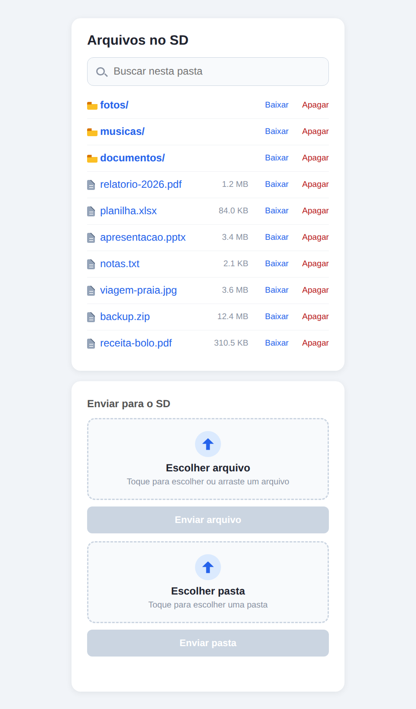
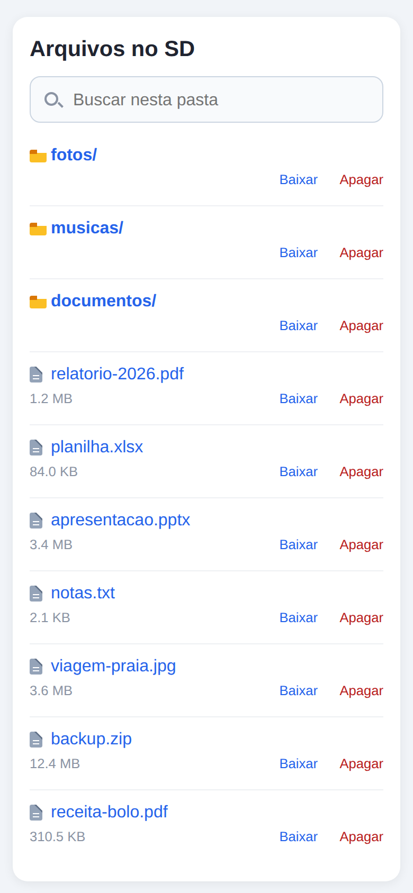

# ludo001

**Um servidor de arquivos Wi-Fi do tamanho de um chaveiro: ESP32 + cartão microSD + o navegador que você já tem.**

Ligue na tomada (ou numa power bank), abra `http://ludo001.local` no celular ou no computador e pronto: navegue, envie, baixe, busque e apague arquivos do cartão — pastas inteiras incluídas, com download em `.zip` montado na hora. Sem app, sem nuvem, sem cadastro.


<table>
  <tr>
    <td align="center"><b>No computador</b></td>
    <td align="center"><b>No celular</b></td>
  </tr>
  <tr>
    <td></td>
    <td></td>
  </tr>
</table>

## Sumário

- [Recursos](#recursos)
- [O que você precisa](#o-que-você-precisa)
- [Ligações (pinagem)](#ligações-pinagem)
- [Começando](#começando)
- [Usando a interface web](#usando-a-interface-web)
- [Tela OLED](#tela-oled)
- [API HTTP](#api-http)
- [Como funciona](#como-funciona)
- [Testes](#testes)
- [Desenvolvimento](#desenvolvimento)
- [Limitações e segurança](#limitações-e-segurança)
- [Solução de problemas](#solução-de-problemas)
- [Licença](#licença)

## Recursos

- **Navegar** pelas pastas do cartão, com ícones de arquivo e de pasta e tamanho de cada item.
- **Enviar arquivos** (clicando ou arrastando) e **pastas inteiras**, preservando a estrutura de subpastas, com barra de progresso.
- **Nunca sobrescreve**: se o nome já existe, o arquivo novo vira `1-nome.ext`, depois `2-nome.ext`, e assim por diante.
- **Baixar arquivos** com um toque e **pastas inteiras como `.zip`**, gerado em *streaming* enquanto baixa — nenhum arquivo é carregado na memória do ESP32.
- **Apagar** arquivos ou pastas (recursivamente), com confirmação.
- **Buscar** pelo nome na pasta aberta, sem diferenciar maiúsculas nem acentos (`relatorio` acha `Relatório Final.pdf`).
- **Mobile first**: a lista quebra em duas linhas no celular para o nome aparecer inteiro, e os alvos de toque são grandes.
- **Lista com rolagem** a partir de 13 itens, para a página não crescer sem fim.
- **Tela OLED** opcional com IP, progresso de envio, quantidade de itens e espaço usado.
- **Endereço fácil**: o ESP32 se anuncia por mDNS como `ludo001.local`.
- **Código testável**: toda a lógica sem hardware (URLs, HTML, formato ZIP, desenho no display) roda e é testada no seu PC, sem placa.

## O que você precisa

| Item | Observação |
|---|---|
| Placa **ESP32** | Testado com ESP32-WROOM-32E em placa genérica de 38 pinos (Micro USB, ponte CP2102) |
| Módulo leitor **microSD (SPI)** | Testado com o módulo "HW-125", que tem regulador de 3,3 V e buffer 74HC125 (veja a nota abaixo sobre a alimentação) |
| Cartão **microSD** | Já formatado em **FAT/FAT32**. O firmware **não formata** o cartão |
| Display **OLED 0,96" SSD1306**, 128×64, I2C | **Opcional.** Sem ele, o firmware só registra o erro no log e segue funcionando |
| **ESP-IDF 6.1** | Veja [Começando](#começando) |
| Rede Wi-Fi **2,4 GHz, WPA2** | O ESP32 não usa 5 GHz |

> **Alimentação do módulo SD:** o módulo testado (com regulador de 3,3 V e buffer) funciona com o pino **VCC em 5 V**. Módulos simples, sem regulador, normalmente precisam de **3,3 V**. Confira o seu antes de ligar.

## Ligações (pinagem)

Os pinos padrão estão em `components/sd_card/include/sd_card.hpp` e `components/oled_display/include/oled_display.hpp`; dá para mudá-los lá.

**Cartão microSD** (SPI, barramento `SPI2`/VSPI, 4 MHz):

| Módulo SD | ESP32 |
|---|---|
| CS | GPIO 5 |
| SCK | GPIO 18 |
| MOSI | GPIO 23 |
| MISO | GPIO 19 |
| VCC | 5 V (módulo com regulador; veja a nota acima) |
| GND | GND |

**Display OLED** (I2C, endereço `0x3C`, 400 kHz):

| OLED | ESP32 |
|---|---|
| SDA | GPIO 21 |
| SCL | GPIO 22 |
| VCC | 3,3 V |
| GND | GND |

## Começando

### 1. Instale o ESP-IDF 6.1

Siga o [guia oficial da Espressif](https://docs.espressif.com/projects/esp-idf/) e, em cada terminal novo, ative o ambiente (`export.sh`, ou o script de ativação do instalador que você usou):

```bash
. $IDF_PATH/export.sh
```

### 2. Baixe o projeto

```bash
git clone <url-deste-repositorio> ludo001
cd ludo001
```

A única dependência externa, `espressif/mdns`, é baixada sozinha pelo gerenciador de componentes na primeira compilação (precisa de internet).

### 3. Configure o Wi-Fi

Crie um arquivo `.env` na raiz do projeto. Ele está no `.gitignore` e **nunca vai para o Git**:

```ini
WIFI_SSID="NomeDaSuaRede"
WIFI="senhaDaSuaRede"
```

> Atenção ao nome da segunda variável: a **senha** fica em `WIFI` (não em `WIFI_PASSWORD`). Não use aspas dentro da senha.

Na compilação, o `main/CMakeLists.txt` lê esse arquivo e gera `wifi_credentials.h`. Sem `.env`, o projeto compila com credenciais vazias e o ESP32 não conecta.

### 4. Compile, grave e acompanhe

Com a placa conectada por USB:

```bash
idf.py -p /dev/ttyUSB0 flash monitor
```

No Windows a porta é do tipo `COM3`; no macOS, `/dev/cu.usbserial-*`. Saia do monitor com `Ctrl+]`.

No log você deve ver algo como:

```
ludo001: wifi connected, ssid=NomeDaSuaRede ip=192.168.0.42
ludo001: sd card mounted, capacity=... MB
ludo001: web server started
```

### 5. Acesse

Abra no navegador, no mesmo Wi-Fi:

- `http://ludo001.local/` — status (Wi-Fi e cartão) e um botão **Ver arquivos**
- `http://ludo001.local/files` — o gerenciador de arquivos

Se o `.local` não abrir (veja [Solução de problemas](#solução-de-problemas)), use o IP que aparece no OLED e no log: `http://192.168.0.42/files`.

## Usando a interface web

- **Abrir uma pasta:** toque no nome dela. O link **↑ pasta anterior** volta um nível.
- **Buscar:** digite no campo no topo da lista. Vale para os itens da pasta aberta; separe várias palavras com espaço (todas precisam aparecer no nome, em qualquer ordem).
- **Baixar um arquivo:** **Baixar** na linha dele.
- **Baixar uma pasta:** **Baixar** na linha da pasta. O navegador recebe `nome-da-pasta.zip`, que descompacta em uma pasta de mesmo nome. A raiz do cartão não pode ser baixada de uma vez.
- **Apagar:** **Apagar** na linha do item, com confirmação. Em pastas, apaga tudo que estiver dentro. **Não há lixeira.**
- **Enviar um arquivo:** toque na caixa *Escolher arquivo* (ou arraste o arquivo para ela) e depois em **Enviar arquivo**.
- **Enviar uma pasta:** toque em *Escolher pasta*, escolha a pasta e toque em **Enviar pasta**. A estrutura de subpastas é recriada no cartão. O envio de pastas depende do suporte do navegador (`webkitdirectory`); em alguns navegadores de celular só é possível escolher arquivos.
- **Nomes repetidos:** viram `1-nome.ext`, `2-nome.ext`… O arquivo original fica intacto. Para *substituir* um arquivo, apague o antigo antes.

Nomes de arquivo com espaços e acentos funcionam (limite de 255 caracteres do FAT com nomes longos). Itens cujo nome começa com `.` ficam ocultos na lista.

## Tela OLED

Com o display ligado, a tela mostra, atualizada a cada 0,4 s:

```
┌──────────────────────────┐
│ IP 192.168.0.42          │  ← faixa de cima: IP, ou "SEM WIFI"
├──────────────────────────┤
│ [██████░░░░░░░░░░░░░░░░] │  ← progresso do envio em andamento
│ ITENS 12                 │  ← itens na raiz do cartão
│ USO 123/14500MB          │  ← espaço usado / livre
└──────────────────────────┘
```

O progresso na tela cobre **envios**; o download de arquivos e de `.zip` não aparece no OLED.

## API HTTP

Tudo que a interface faz é HTTP simples, então dá para automatizar com `curl`. `<caminho>` é relativo à raiz do cartão (`pasta/sub/arquivo.txt`) e precisa estar codificado como URL (espaço vira `%20`).

| Método | Rota | O que faz |
|---|---|---|
| `GET` | `/` | Página de status |
| `GET` | `/files` | Lista a raiz do cartão (HTML) |
| `GET` | `/files/<caminho>` | Baixa o arquivo; se for pasta, lista o conteúdo (HTML) |
| `GET` | `/zip/<pasta>` | Baixa a pasta e tudo dentro dela como `<pasta>.zip` |
| `POST` | `/upload/<caminho>` | Grava o corpo da requisição como arquivo, criando as pastas que faltarem. Se o nome existir, grava como `N-nome` |
| `POST` | `/delete/<caminho>` | Apaga o arquivo, ou a pasta com tudo dentro |
| `GET` | `/style.css`, `/app.js` | Arquivos estáticos da interface |

Exemplos:

```bash
# enviar (o corpo da requisição é o próprio arquivo)
curl -X POST --data-binary @foto.jpg http://ludo001.local/upload/foto.jpg
curl -X POST --data-binary @a.txt   http://ludo001.local/upload/viagem/dia1/a.txt

# baixar um arquivo, ou uma pasta inteira como zip
curl -o foto.jpg   http://ludo001.local/files/foto.jpg
curl -o viagem.zip http://ludo001.local/zip/viagem

# apagar
curl -X POST http://ludo001.local/delete/foto.jpg
```

Códigos de resposta que valem saber:

| Código | Quando |
|---|---|
| `400` | Nome inválido (vazio, começando com `/`, ou contendo `..`), cartão não montado, ou `/zip/` sem pasta (raiz) |
| `404` | Arquivo ou pasta inexistente; `/zip/` apontando para um arquivo, não uma pasta |
| `413` | A pasta pediu um `.zip` maior que 4 GiB ou com mais de 65535 itens |
| `500` | Falha ao abrir o arquivo para escrita, ou envio interrompido (o arquivo parcial é removido) |

O `.zip` usa entradas sem compressão (*stored*) e data fixa `1980-01-01 00:00` (a placa não tem relógio). Arquivos que começam com `.` não entram.

## Como funciona

```
main/ludo001.cpp          app_main: liga OLED, Wi-Fi, cartão e servidor; laço de status
components/
├── wifi_manager/         Wi-Fi em modo estação (conecta e reconecta sozinho)
├── sd_card/              microSD por SPI, montado como FAT em /sdcard
├── oled_display/         transporte I2C do SSD1306
├── framebuffer/          desenho de pixels, linhas e texto (fonte de traços) — lógica pura
├── web_server/           servidor esp_http_server + web/ (index.html, files.html, style.css, app.js)
└── web_content/          lógica pura do servidor: URL, nomes numerados, HTML dos itens, formato ZIP
host_tests/               projeto separado: testes Unity que rodam no PC (target linux)
```

Decisões que moldam o código:

- **Separação entre lógica pura e hardware.** Tudo que não precisa de `esp_*` (codificação de URL, montagem da lista, registros do ZIP, desenho no display) fica em `web_content` e `framebuffer`, sem dependências do ESP-IDF — por isso compila para o PC e é testado lá. O que toca hardware (`httpd`, SPI, I2C) fica em adaptadores finos.
- **A interface é feita de arquivos de verdade.** HTML, CSS e JavaScript vivem em `components/web_server/web/` e são embutidos no firmware na compilação (`EMBED_TXTFILES`); não há páginas escritas dentro de strings em C++. Só fragmentos dinâmicos pequenos (a lista de itens, as etiquetas de status) são montados em C++ e encaixados nos modelos `{{TOKEN}}`.
- **ZIP em streaming.** Cada arquivo é lido em blocos de 1 KB, o CRC-32 é calculado no caminho e gravado num *data descriptor* depois dos dados; o diretório central é enviado no fim. O consumo de memória não depende do tamanho dos arquivos, só do número de itens: a lista de nomes da pasta fica na RAM durante o download.
- **Busca no navegador.** A pasta aberta já está inteira na página, então o filtro roda no JavaScript do cliente, sem pedir nada ao ESP32.

## Testes

A suíte roda no seu PC, sem placa. Uma vez, instale a dependência do alvo `linux` do ESP-IDF:

```bash
sudo apt-get install -y libbsd-dev
```

Depois, a partir da raiz do projeto, com o ambiente do ESP-IDF ativo:

```bash
export PATH="/usr/bin:$PATH"   # compilador do PC na frente do cross-compilador
idf.py -C host_tests build
./host_tests/build/ludo001_host_tests.elf
```

O esperado é uma linha `:PASS` por teste e, no fim, `N Tests 0 Failures 0 Ignored` seguido de `OK`. O programa sai com código diferente de zero se algum teste falhar. Mais detalhes em [`host_tests/README.md`](host_tests/README.md).

O HTML/CSS/JS da interface e o servidor em si (`httpd`, cartão SD) não têm testes automatizados; eles são verificados na placa.

## Desenvolvimento

- **Mexendo na interface:** edite os arquivos em `components/web_server/web/`, compile e grave de novo. Eles ficam dentro do firmware, não no cartão.
- **Texto da interface** em português **sem acentos** (`Apagar`, `Pasta vazia`, `Baixar`); mensagens de erro HTTP e logs em inglês.
- **Nova lógica pura:** coloque em `web_content`, escreva o teste em `host_tests/main/test_*.cpp`, declare-o e registre-o com `RUN_TEST(...)` em `test_main.cpp`.
- **Espaço no firmware:** a partição de aplicação tem 1 MB e o firmware já ocupa cerca de 97% dela. Antes de acrescentar algo grande, confira a folga no fim do `idf.py build` ou ajuste a tabela de partições e o tamanho da flash (`idf.py menuconfig`).
- **Rotas HTTP:** o servidor usa as 8 rotas que o `HTTPD_DEFAULT_CONFIG()` permite. Para adicionar uma, aumente `config.max_uri_handlers` em `web_server.cpp`.
- **Commits:** uma linha de assunto, em inglês, no imperativo, sem ponto final (`Add a search box that filters the files in the current folder`).

## Limitações e segurança

> **Sem autenticação e sem HTTPS.** Qualquer pessoa na mesma rede Wi-Fi pode ver, baixar, enviar e **apagar** tudo no cartão. Use em rede de confiança e **nunca exponha o ESP32 à internet** (nem com redirecionamento de portas).

- A senha do Wi-Fi fica **embutida no binário do firmware** (gerado a partir do `.env`). Não compartilhe os arquivos `.bin` que você compilar.
- A busca olha só os nomes da pasta aberta; não procura dentro das subpastas.
- Apagar é definitivo; não existe lixeira.
- `.zip` limitado a 4 GiB e 65535 itens (sem ZIP64), sem compressão e sem datas reais.
- Substituir um arquivo exige apagar o antigo antes (enviar de novo cria uma cópia numerada).
- A velocidade é limitada pelo Wi-Fi do ESP32 e pelo SPI do cartão (4 MHz): nos testes de download de pastas ficou na casa de uma centena de KB/s. Pastas grandes demoram.
- No máximo 5 arquivos abertos ao mesmo tempo no cartão.
- `.zip` de pastas com um número enorme de itens pode não caber na RAM (a lista de nomes é montada antes de enviar).
- Uso simultâneo por várias pessoas, com envios grandes ao mesmo tempo, não foi testado.

## Solução de problemas

| Sintoma | O que verificar |
|---|---|
| OLED mostra **SEM WIFI** | Confira o `.env` (`WIFI_SSID` e `WIFI`), se a rede é 2,4 GHz com WPA2 e se o sinal chega até a placa. O log mostra `wifi connect failed` |
| `ludo001.local` não abre | Nem todo sistema ou rede resolve mDNS (por exemplo, redes que isolam os clientes entre si). Use o IP mostrado no OLED e no log |
| Página abre, mas diz **SD card nao montado** | Confira a ligação (CS 5, SCK 18, MOSI 23, MISO 19), a **alimentação do módulo (5 V ou 3,3 V, conforme o módulo)** e se o cartão está em FAT/FAT32. O log mostra `sd card mount failed` |
| OLED apagado | O display é opcional. Confira SDA 21 / SCL 22, o endereço `0x3C` e o log (`display init failed`) |
| `idf.py` falha dizendo que não acha o Python do ambiente | O ambiente do ESP-IDF não foi ativado nesse terminal, ou precisa ser reinstalado |
| `Permission denied` em `/dev/ttyUSB0` | Adicione seu usuário ao grupo `dialout` (`sudo usermod -aG dialout $USER`) e entre de novo na sessão |
| Envio de pasta só deixa escolher arquivos | O navegador não suporta `webkitdirectory`; use um navegador de computador ou envie os arquivos um a um |
| O download de uma pasta falha no meio | Normal se a conexão cair: o servidor encerra a conexão em vez de entregar um `.zip` truncado. Tente de novo |

## Licença

Este repositório ainda não tem um arquivo de licença. Até que um seja adicionado, vale a regra padrão: sem licença expressa, o código não pode ser reutilizado livremente.
